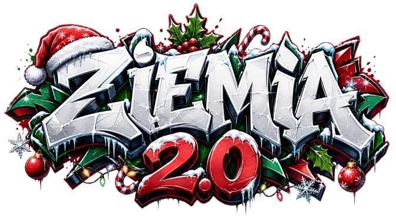

<!DOCTYPE html>
<html lang="pl">
<head>
    <meta charset="UTF-8">
    <meta name="viewport" content="width=device-width, initial-scale=1.0">
    <title>ZIEMIA 2.0 – Centrum Społeczności & Hall of Fame</title>
    <link rel="preconnect" href="https://fonts.googleapis.com">
    <link rel="preconnect" href="https://fonts.gstatic.com" crossorigin>
    <link href="https://fonts.googleapis.com/css2?family=Inter:wght@400;500;600;700;800;900&family=JetBrains+Mono:wght@500;700&display=swap" rel="stylesheet">
    
</head>
<body>

    

        <nav class="navbar">
            

                
                ZIEMIA 2.0
            

            

                
                KICK & TWITCH LIVE BOT
            

        </nav>

        <header class="hero">
            <h1>CENTRUM SPOŁECZNOŚCI ZIEMIA 2.0</h1>
            
Automatyczne shoty 1080p Full HD, zrzuty ekranu PNG oraz animacje GIF 640p tworzone na żywo przez społeczność Discorda.

        </header>

        

            <video id="intro-video" controls preload="metadata"></video>
        

        <section class="stats-grid">
            

                

                    Wycięte Shoty 1080p
                    🎬
                

                
—

                
Klipów wideo nagranych na serwerze

            

            

                

                    Zrzuty Ekranu HD
                    📸
                

                
—

                
Bezstratnych klatek PNG ze streamów

            

            

                

                    Animacje GIF 640p
                    🎞️
                

                
—

                
Wygenerowanych animacji z transmisji

            

        </section>

        <section class="terminal-section">
            

                <h3 class="terminal-title">💻 Terminal na żywo & Aktywność</h3>
                Ostatnie zdarzenia na serwerze
            

            

                
Ładowanie aktywności...

            

        </section>

        <section>
            

                <h2 class="section-title">🏆 Hall of Fame – Najaktywniejsi Twórcy</h2>
                
Punktacja: 🎬 Shot = <strong>3 pkt</strong> &bull; 🎞️ GIF = <strong>2 pkt</strong> &bull; 📸 Screen = <strong>1 pkt</strong>

            

            

            

        </section>

        <footer class="footer">
            
ZIEMIA 2.0 &bull; Statystyki synchronizowane automatycznie z serwerem Discord

        </footer>
    

    
</body>
</html>